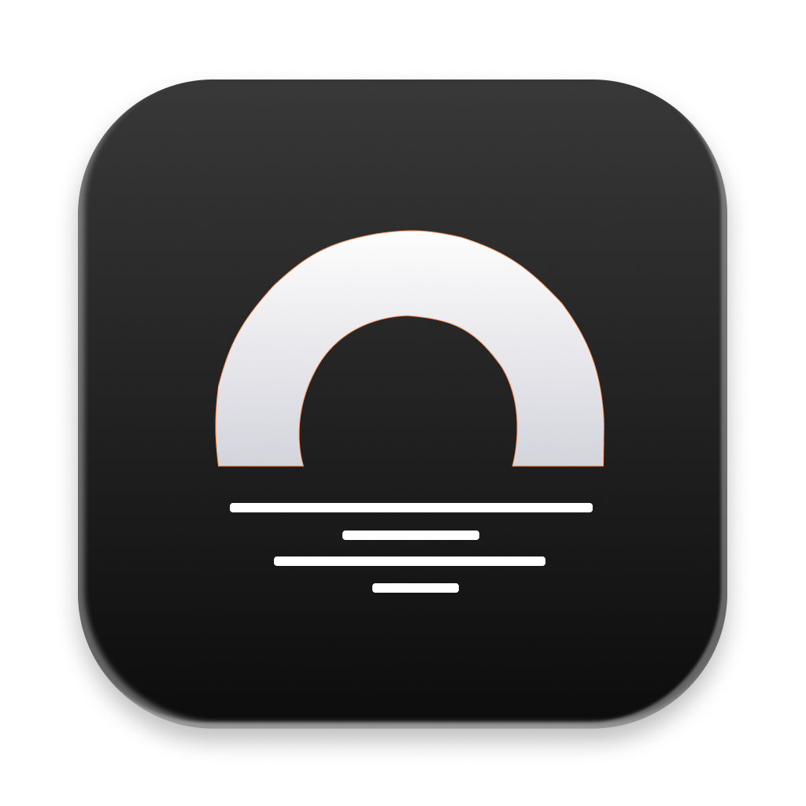

<a id="readme-top"></a>

<!-- PROJECT LOGO -->
<br />
<div align="center">
  <a href="https://github.com/alchaplinsky/osoji">
    
  </a>

  <h3 align="center">Osoji</h3>

  <p align="center">
    See what fills your Mac. Clean it up without fear.
    <br />
    An open-source disk explorer and cleaner for macOS, with a sunburst and a high-performance scanner built to keep full-disk scans short.
    <br />
    <br />
    <a href="https://github.com/alchaplinsky/osoji/releases/latest"><strong>Download the latest release »</strong></a>
    <br />
    <br />
    <!-- PROJECT SHIELDS -->
    <a href="https://github.com/alchaplinsky/osoji/releases/latest"></a>
    <a href="https://github.com/alchaplinsky/osoji/actions/workflows/ci.yml"></a>
    <a href="https://github.com/alchaplinsky/osoji/releases/latest"></a>
    <br />
    <br />
    <a href="https://github.com/alchaplinsky/osoji/issues/new?labels=bug">Report a bug</a>
    &middot;
    <a href="https://github.com/alchaplinsky/osoji/issues/new?labels=enhancement">Request a feature</a>
    &middot;
    <a href="docs/spec.md">Read the spec</a>
  </p>
</div>

<!-- TABLE OF CONTENTS -->
<details>
  <summary>Table of Contents</summary>
  <ol>
    <li><a href="#about-the-project">About The Project</a></li>
    <li><a href="#features">Features</a></li>
    <li><a href="#how-fast-is-it">How fast is it</a></li>
    <li><a href="#safety-first">Safety first</a></li>
    <li><a href="#built-with">Built With</a></li>
    <li><a href="#getting-started">Getting Started</a></li>
    <li><a href="#usage">Usage</a></li>
    <li><a href="#development">Development</a></li>
    <li><a href="#roadmap">Roadmap</a></li>
    <li><a href="#contributing">Contributing</a></li>
    <li><a href="#license">License</a></li>
    <li><a href="#acknowledgments">Acknowledgments</a></li>
  </ol>
</details>

<!-- ABOUT THE PROJECT -->
## About The Project

[![Osoji scanning a Mac][product-screenshot]](https://github.com/alchaplinsky/osoji)

Osoji (お掃除, "cleaning") shows your disk as a sunburst you can click into, ring by ring, until you find what is actually taking the space. Then it tells you what is safe to remove, what is worth a look, and what it would keep, and it moves the rest to the Trash for you.

It exists because the good disk visualisers for the Mac are closed source and the open ones are slow or ugly. Osoji is neither. Its scanner is written in Rust on top of the same low-level `getattrlistbulk` call that Finder uses, so a full disk with ten million files is on screen in about half a minute, and the whole app is yours to read, fork and fix.

**What makes it different**

- **Fast enough to scan the whole disk every time.** Ahead of `dua-cli`, `jwalk` and `du` on the same machine.
- **Stays current while it is open.** An FSEvents watcher keeps the finished scan in sync with the disk. Build a project, empty a cache, trash a folder, and the chart updates. No rescan.
- **Suggestions you can trust.** A readable policy file decides what is safe, what needs review, and what must never be touched. Every suggestion comes with a reason and the bytes it frees.
- **Nothing goes until you review.** Items collect in a bin. You confirm the total. Everything goes to the macOS Trash, never to oblivion.
- **Small.** Around 26 bytes of memory per file, names included. An 8.9-million-entry home folder fits in 236 MB.

<p align="right">(<a href="#readme-top">back to top</a>)</p>

<!-- FEATURES -->
## Features

- **Four ways to look at a folder.** Sunburst, treemap, shelf and orbit views, with breadcrumbs, hover labels and a list panel for the current ring.
- **Breakdown.** A capacity bar for the disk with Users, Applications, System, Library and friends, plus Free and Not scanned so the numbers add up to what Finder reports.
- **Largest files.** The biggest files on the disk, filterable to the ones that are safe to remove or over a year old.
- **Suggestions.** Developer caches (`node_modules`, `target/`, DerivedData, iOS DeviceSupport, Gradle, npm, cargo, bun), app caches, old downloads, large stale files, Docker disk images and virtual machines, grouped as *Safe to remove*, *Worth a look* and *We would keep these*. A *Worth knowing* group flags things that are usually not there, like an unknown top-level folder or another user's home.
- **Watchers.** Keep an eye on folders that tend to grow, such as Downloads or a caches folder, and set a size limit for each.
- **Scan any disk or folder.** Pick a volume or a folder in the sidebar. The chart's centre is whatever you picked.
- **Full Disk Access aware.** Without it, Osoji still scans everything it can, shows a lock on what it could not read, and offers a one-click jump to the right System Settings pane.
- **Reveal in Finder, open the Trash.** Everything you sweep can be put back from the Trash until you empty it.
- **Themes and layouts.** Instrument, Glass and Light themes. Floating cards or classic panes.
- **Updates itself.** Signed, notarized universal builds, checked on launch from GitHub Releases, with a one-click restart.

<p align="right">(<a href="#readme-top">back to top</a>)</p>

<!-- PERFORMANCE -->
## How fast is it

Full disk scan from `/` on a MacBook Pro (M3 Pro, 12 cores, APFS), 8 threads, 10.6 million entries, 601 GB allocated. Numbers from [`tools/bench/NOTES.md`](tools/bench/NOTES.md).

| Scanner | Cold cache | Warm cache | Peak memory |
| --- | ---: | ---: | ---: |
| **Osoji** | **34 s** | **30 s** | **~330 MB** |

And on an 8.9-million-entry home folder, warm cache, 8 threads:

| Walker | Median | vs Osoji | Peak memory |
| --- | ---: | ---: | ---: |
| **Osoji (`getattrlistbulk`)** | **23.7 s** | 1.00× | 236 MB |
| dua-cli | 32.1 s | 1.35× | 116 MB |
| jwalk | 43.5 s | 1.83× | 476 MB |
| `du -skx` | 227 s | 9.6× | 45 MB |

Totals match `du` within 0.02%, with hard links counted once. The scanner never reads file contents, never follows symlinks and never crosses a mount unless you ask it to.

How it gets there, in short: every worker thread drains `getattrlistbulk` into a thread-local buffer, writes a whole directory into a shared arena as one contiguous block, and aggregates sizes in post-order while the scan is still running. There is no second pass, no `String` or `PathBuf` allocation per entry, and nothing of the tree ever crosses the IPC boundary. The UI asks for the slice it is about to draw and gets back a few kilobytes.

<p align="right">(<a href="#readme-top">back to top</a>)</p>

<!-- SAFETY -->
## Safety first

Disk cleaners are only useful if you dare to press the button. Osoji is built around that.

- **Trash only.** The app moves items to the macOS Trash and nothing else. "Delete permanently" is in the UI and disabled.
- **Review before anything moves.** Dropped and ticked items sit in a bin until you open the review sheet, see the total, and confirm. A setting asks once more for anything over 1 GB.
- **Protected paths are off limits.** `/System`, `/Library`, `/usr`, your home folder, Keychains, Mail, Messages, iCloud Drive, Dropbox and the like are never offered and cannot be swept. Personal folders such as Desktop and Documents are marked risky and ask twice.
- **Readable rules.** The policy lives in one TOML file, [`src-tauri/crates/scan-policy/policy/macos.toml`](src-tauri/crates/scan-policy/policy/macos.toml), with an id, a reason and a safety level per rule. Read it, argue with it, send a pull request.
- **Nothing inside a bundle.** `.app`, `.photoslibrary`, `.framework` and other packages are treated as one thing. Osoji never suggests pulling a file out of one.

<p align="right">(<a href="#readme-top">back to top</a>)</p>

### Built With

[![Rust][Rust-badge]][Rust-url] [![Tauri][Tauri-badge]][Tauri-url] [![React][React-badge]][React-url] [![TypeScript][TypeScript-badge]][TypeScript-url] [![Vite][Vite-badge]][Vite-url] [![Bun][Bun-badge]][Bun-url]

<p align="right">(<a href="#readme-top">back to top</a>)</p>

<!-- GETTING STARTED -->
## Getting Started

### Install

1. Download the latest `.dmg` from the [Releases page](https://github.com/alchaplinsky/osoji/releases/latest).
2. Drag Osoji to Applications and open it.
3. Optional but recommended: grant **Full Disk Access** when the banner asks, so Mail, Messages, Safari and other protected folders are counted too. Relaunch Osoji afterwards.

Osoji runs on Apple Silicon and Intel Macs from a single universal build. It is signed and notarized, and it checks GitHub Releases for updates when it starts.

### Build from source

Prerequisites: [Rust](https://rustup.rs) (stable), [Bun](https://bun.sh), Xcode command-line tools.

```sh
git clone https://github.com/alchaplinsky/osoji.git
cd osoji
bun install
bun tauri dev           # dev build with hot reload
bun tauri build         # .app and .dmg under src-tauri/target/release/bundle
```

#### Linux

Osoji builds and runs on Linux: it scans with the portable `jwalk` walker, keeps the scan current through an inotify watcher, lists the real mounts, and has its own cleanup policy in [`src-tauri/crates/scan-policy/policy/linux.toml`](src-tauri/crates/scan-policy/policy/linux.toml). The native `getdents64`/`statx` walker is still to come. On Debian or Ubuntu, install the Tauri prerequisites first:

```sh
sudo apt-get install libwebkit2gtk-4.1-dev build-essential curl wget file libxdo-dev libssl-dev libayatana-appindicator3-dev librsvg2-dev patchelf
bun tauri dev
bun tauri build --bundles appimage,deb   # under src-tauri/target/release/bundle
```

The release workflow publishes an AppImage and a `.deb` for x86_64. Only the AppImage updates itself; a `.deb` install is updated by installing the next `.deb`.

<p align="right">(<a href="#readme-top">back to top</a>)</p>

<!-- USAGE -->
## Usage

1. **Pick what to scan.** The sidebar lists your volumes. Choose one, or pick a folder, and press scan. How long a full disk takes depends on its size and file count; the first run is the slowest, since nothing is cached yet.
2. **Explore.** Click a ring to look inside it. Click the centre to go back up. Hover for sizes, switch between sunburst, treemap, shelf and orbit, or open the list panel for the exact numbers.
3. **Collect.** Drag items into the bin at the bottom, or tick them. Jump to **Largest files** or **Suggestions** to find candidates faster. "Add all safe items" fills the bin with everything the policy marks safe.
4. **Review and free up.** Open the review sheet, read the total, confirm. Items go to the Trash and the chart updates in place.
5. **Keep it tidy.** Turn on **Watchers** in Settings, add folders that tend to grow, and set a limit for each.

### Run the scanner alone

The scanner is a separate crate with a headless CLI, which is also how the benchmarks are run.

```sh
cargo build --release -p scan-cli --manifest-path src-tauri/Cargo.toml
src-tauri/target/release/scan-cli ~ --threads 8     # human-readable output
src-tauri/target/release/scan-cli / --json          # one JSON line
```

<p align="right">(<a href="#readme-top">back to top</a>)</p>

<!-- DEVELOPMENT -->
## Development

```
src/                          React + Vite UI: design tokens (src/design), primitives (src/components/ui), screens (src/screens)
src-tauri/                    Tauri 2 backend and Cargo workspace root: owns the scan, serves bounded views, reveal, trash, live updates
src-tauri/crates/scan-core    arena, flags, child index, hard-link dedup, progress, jwalk reference walker
src-tauri/crates/scan-macos   getattrlistbulk walker with a work-stealing deque, FSEvents watcher
src-tauri/crates/scan-policy  protected / risky / cleanup rules and the matcher
src-tauri/crates/scan-cli     headless scanner used for benchmarks
tests/e2e                     WebdriverIO suite that drives the real app
tools/bench/                  harness, report, external app timer
docs/                         spec, benchmark plan, release procedure
```

### Lint and test

```sh
bun run lint            # eslint + tsc
bun run test            # vitest unit tests (src/**/*.test.ts)
cargo fmt --check --manifest-path src-tauri/Cargo.toml
cargo clippy --workspace --all-targets --manifest-path src-tauri/Cargo.toml -- -D warnings
cargo test --workspace --manifest-path src-tauri/Cargo.toml
bun run test:e2e:build  # debug build with --features webdriver, then WebdriverIO drives the app
```

The e2e suite talks to a WebDriver server that `tauri-plugin-webdriver` runs on port 4445 in builds made with `--features webdriver`, never in release bundles. It starts Vite and the app itself and points the app's `HOME` at a small fixture folder.

CI runs all of the above on pull requests and on `main`. The frontend checks, the `scan-core` and `scan-policy` crates, and a build and test of the app crate (with the jwalk walker and no file watcher) run on Linux. `scan-macos` and the e2e suite only build on macOS, so they run on a macOS runner.

### Releasing

Releases are built, signed, notarized and published to GitHub Releases by the **Release** workflow. Installed apps pick them up on launch. See [`docs/RELEASING.md`](docs/RELEASING.md) for the one-time setup and the per-release steps.

<p align="right">(<a href="#readme-top">back to top</a>)</p>

<!-- ROADMAP -->
## Roadmap

- [x] Rust scan core with arena, hard-link dedup and a jwalk reference walker
- [x] `getattrlistbulk` walker with in-scan aggregation, faster than dua-cli
- [x] Tauri app with live progress, bounded binary views and the sunburst
- [x] Full Disk Access detection and banner
- [x] Cleanup policy, collector bin, review sheet and Trash
- [x] FSEvents watcher that keeps a finished scan current without a rescan
- [x] Signed, notarized universal builds with in-app updates
- [ ] Background watching with a nudge when a watched folder passes its limit
- [ ] Duplicate finder (size, then blake3 prefix, then full hash, on demand)
- [ ] Privacy cleanup: browser history, cookies and recent-item lists
- [ ] Cached snapshot for a first pixel in under 300 ms
- [ ] Clone accounting (shared vs unique bytes on APFS)
- [ ] Linux, in progress: builds, scans with the `jwalk` walker, live updates through inotify, real volumes, a Linux cleanup policy, and ships as an AppImage and a `.deb`; the native `getdents64`/`statx` walker is still to come. Windows after that.

See the [open issues](https://github.com/alchaplinsky/osoji/issues) for the full list and the [spec](docs/spec.md) for the design behind each milestone.

<p align="right">(<a href="#readme-top">back to top</a>)</p>

<!-- CONTRIBUTING -->
## Contributing

Contributions are what make the open source community such an amazing place to learn, inspire, and create. Any contributions you make are **greatly appreciated**.

A few places where help is especially welcome:

- **Cleanup rules.** Know a cache that is safe to drop, or a folder that should never be touched? Add a rule to `policy/macos.toml` with a reason.
- **Benchmarks on other machines.** Run `tools/bench/run_home.sh` and send the numbers.
- **Linux and Windows walkers.** The spec has a design for both.

1. Fork the project
2. Create your feature branch (`git checkout -b feat/amazing-feature`)
3. Commit your changes (`git commit -m 'feat: add amazing feature'`)
4. Push to the branch (`git push origin feat/amazing-feature`)
5. Open a pull request

Please run the lint and test commands above before opening the PR. CI runs the same set.

<p align="right">(<a href="#readme-top">back to top</a>)</p>

<!-- LICENSE -->
## License

Osoji is open source. The licence file is on its way; until it lands, treat the code as all rights reserved and open an issue if you need to ship it somewhere.

<p align="right">(<a href="#readme-top">back to top</a>)</p>

<!-- ACKNOWLEDGMENTS -->
## Acknowledgments

* [DaisyDisk](https://daisydiskapp.com) for showing what a disk map should look like
* [dua-cli](https://github.com/Byron/dua-cli) and [jwalk](https://github.com/Byron/jwalk), the reference walkers Osoji is measured against
* [Tauri](https://tauri.app) for a native shell without an Electron-sized bill
* [Lucide](https://lucide.dev) for the icons, [Geist Mono](https://vercel.com/font) and [Hanken Grotesk](https://github.com/marcologous/hanken-grotesk) for the type
* [Best-README-Template](https://github.com/othneildrew/Best-README-Template) for the shape of this file

<p align="right">(<a href="#readme-top">back to top</a>)</p>

<!-- MARKDOWN LINKS & IMAGES -->
[product-screenshot]: docs/assets/screenshot.png
[Rust-badge]: https://img.shields.io/badge/Rust-000000?style=for-the-badge&logo=rust&logoColor=white
[Rust-url]: https://www.rust-lang.org
[Tauri-badge]: https://img.shields.io/badge/Tauri%202-24C8D8?style=for-the-badge&logo=tauri&logoColor=white
[Tauri-url]: https://tauri.app
[React-badge]: https://img.shields.io/badge/React%2018-20232A?style=for-the-badge&logo=react&logoColor=61DAFB
[React-url]: https://react.dev
[TypeScript-badge]: https://img.shields.io/badge/TypeScript-3178C6?style=for-the-badge&logo=typescript&logoColor=white
[TypeScript-url]: https://www.typescriptlang.org
[Vite-badge]: https://img.shields.io/badge/Vite-646CFF?style=for-the-badge&logo=vite&logoColor=white
[Vite-url]: https://vite.dev
[Bun-badge]: https://img.shields.io/badge/Bun-000000?style=for-the-badge&logo=bun&logoColor=white
[Bun-url]: https://bun.sh
